# Phase 1 - Dataset Understanding & Exploratory Data Analysis

**Project:** Bank Marketing Intelligence System  
**Course context:** Information Systems Management  
**Generated:** 2026-11-17 17:36:11  
**Dataset:** `data/raw/bank-full.csv`  
**Records / columns:** 45,211 / 17  
**Tools:** Python 3, Pandas, NumPy, Matplotlib, Seaborn  
**Scope:** Phase 1 only - no machine-learning models were trained.

---

## 1. Executive summary

- The dataset contains **45,211 customer contacts** and **17 attributes** describing client profile, current-campaign contact details, and previous-campaign history.
- Only **5,289 customers (11.70%) subscribed** to a term deposit; **39,922 (88.30%) did not**. The majority-to-minority ratio is **7.55:1**, a clear class-imbalance problem.
- A trivial 'always no' classifier would already score **88.30% accuracy**, which shows why accuracy alone cannot evaluate marketing models.
- There are **no NULL cells** and **0 duplicate rows**. Data completeness is high, but **52,124 'unknown' category values** require interpretation rather than deletion.
- **36,954 records (81.74%) have `pdays = -1`**, meaning the customer had never been contacted before. This is a sentinel value, not a real elapsed-day count.
- Previous-campaign success is the strongest behavioural signal: **64.73%** of customers with `poutcome = success` subscribed, versus **9.16%** for `unknown`.
- **9,732 blue-collar customers** form the largest occupational group, but convert at only **7.27%** - well below the 11.70% baseline. Smaller groups such as students (28.68%, n=938) and retirees (22.79%, n=2,264) convert far better.

---

## 2. Dataset overview (Task A)

The file was loaded with `pd.read_csv(path, sep=';')`, validated against the documented 17-column schema, and inspected without modification. The raw CSV is **4,502.3 KB** and uses the UCI Bank Marketing schema (17 attributes, target `y`).

| column | dtype | role | unique_values |
| --- | --- | --- | --- |
| age | int64 | numeric | 77 |
| job | object | categorical | 12 |
| marital | object | categorical | 3 |
| education | object | categorical | 4 |
| default | object | categorical | 2 |
| balance | int64 | numeric | 7,168 |
| housing | object | categorical | 2 |
| loan | object | categorical | 2 |
| contact | object | categorical | 3 |
| day | int64 | numeric | 31 |
| month | object | categorical | 12 |
| duration | int64 | numeric | 1,573 |
| campaign | int64 | numeric | 48 |
| pdays | int64 | numeric | 559 |
| previous | int64 | numeric | 41 |
| poutcome | object | categorical | 4 |
| y | object | target | 2 |

### Dataset-level summary

| metric | value |
| --- | --- |
| rows | 45,211 |
| columns | 17 |
| numeric variables | 7 |
| categorical variables | 9 |
| missing cells | 0 |
| duplicate rows | 0 |
| unknown categorical cells | 52,124 |
| subscribers (yes) | 5,289 |
| non-subscribers (no) | 39,922 |
| imbalance ratio (no:yes) | 7.55 |
| majority-class baseline accuracy (%) | 88.30 |

---

## 3. Data quality (Task B)

### 3.1 Missing values

Across all 45,211 rows and 17 columns there are **0 NULL/NaN cells**. No imputation is required from a technical standpoint; the more important issue is the explicit 'unknown' category described below.

### 3.2 Duplicate records

Exact duplicate rows: **0** (0.00% of the dataset). No duplicates were removed.

### 3.3 'unknown' categorical values

'unknown' is a *category*, not a standard missing value. It was counted per column and kept intact. Counts below are of all records.

| column | unknown_count | unknown_pct | unique_categories |
| --- | --- | --- | --- |
| poutcome | 36,959 | 81.75 | 4 |
| contact | 13,020 | 28.80 | 3 |
| education | 1,857 | 4.11 | 4 |
| job | 288 | 0.64 | 12 |
| marital | 0 | 0.00 | 3 |
| housing | 0 | 0.00 | 2 |
| default | 0 | 0.00 | 2 |
| loan | 0 | 0.00 | 2 |
| month | 0 | 0.00 | 12 |

The highest unknown rate is **`contact` (28.80%)** and **`poutcome` (81.75%)**. `poutcome = unknown` largely overlaps with never having been contacted before, so it carries information rather than being random missingness. There are 36,959 `poutcome = unknown` records but only 36,954 never-contacted records, so 5 customers have previous contact history without a recorded outcome. `job` and `education` have small unknown shares.

### 3.4 Special value pdays = -1

- `pdays = -1`: **36,954** records (**81.74%**).
- `previous = 0`: **36,954** records.
- Records where `pdays` / `previous` disagree: **0**.

`-1` is a sentinel meaning **'client not previously contacted'**, not one day before the campaign. Numeric summaries and correlations that include `-1` describe contact history, not elapsed time.

---

## 4. Statistical analysis (Task C)

### 4.1 Numerical variables

| variable | count | mean | std | min | q25 | median | q75 | max | skewness |
| --- | --- | --- | --- | --- | --- | --- | --- | --- | --- |
| age | 45,211 | 40.94 | 10.62 | 18.00 | 33.00 | 39.00 | 48.00 | 95.00 | 0.68 |
| balance | 45,211 | 1362.27 | 3044.77 | -8019.00 | 72.00 | 448.00 | 1428.00 | 102127.00 | 8.36 |
| day | 45,211 | 15.81 | 8.32 | 1.00 | 8.00 | 16.00 | 21.00 | 31.00 | 0.09 |
| duration | 45,211 | 258.16 | 257.53 | 0.00 | 103.00 | 180.00 | 319.00 | 4918.00 | 3.14 |
| campaign | 45,211 | 2.76 | 3.10 | 1.00 | 1.00 | 2.00 | 3.00 | 63.00 | 4.90 |
| pdays | 45,211 | 40.20 | 100.13 | -1.00 | -1.00 | -1.00 | -1.00 | 871.00 | 2.62 |
| previous | 45,211 | 0.58 | 2.30 | 0.00 | 0.00 | 0.00 | 0.00 | 275.00 | 41.85 |

Account balance is highly right-skewed (skewness 8.36), ranges from -8,019 to 102,127 EUR, and includes **3,766 negative balances** (8.33%). Duration and campaign counts are likewise concentrated at low values with long tails.

### 4.2 Categorical variables

`categorical_summary.csv` contains every category with counts and percentages. The largest groups are married customers, secondary education, and blue-collar occupations; the target is strongly dominated by 'no'.

Top categories per variable:

| column | value | count | pct_of_column (%) |
| --- | --- | --- | --- |
| contact | cellular | 29,285 | 64.77 |
| contact | unknown | 13,020 | 28.80 |
| contact | telephone | 2,906 | 6.43 |
| default | no | 44,396 | 98.20 |
| default | yes | 815 | 1.80 |
| education | secondary | 23,202 | 51.32 |
| education | tertiary | 13,301 | 29.42 |
| education | primary | 6,851 | 15.15 |
| housing | yes | 25,130 | 55.58 |
| housing | no | 20,081 | 44.42 |
| job | blue-collar | 9,732 | 21.53 |
| job | management | 9,458 | 20.92 |
| job | technician | 7,597 | 16.80 |
| loan | no | 37,967 | 83.98 |
| loan | yes | 7,244 | 16.02 |
| marital | married | 27,214 | 60.19 |
| marital | single | 12,790 | 28.29 |
| marital | divorced | 5,207 | 11.52 |
| month | may | 13,766 | 30.45 |
| month | jul | 6,895 | 15.25 |
| month | aug | 6,247 | 13.82 |
| poutcome | unknown | 36,959 | 81.75 |
| poutcome | failure | 4,901 | 10.84 |
| poutcome | other | 1,840 | 4.07 |

### 4.3 Target distribution and class imbalance

| y | count | percentage |
| --- | --- | --- |
| no | 39,922 | 88.30 |
| yes | 5,289 | 11.70 |

- Non-subscription: **88.30%** | Subscription: **11.70%**.
- Ratio: **7.55 non-subscribers for every subscriber**.
- A majority-class-only baseline reaches **88.30% accuracy** while identifying zero potential customers.

This is a **class-imbalance problem**. Model selection in later phases must use precision, recall, F1, ROC-AUC / PR-AUC, lift, and campaign-cost-based evaluation - not accuracy alone. Any resampling or class weighting must be fitted inside training folds only to avoid validation leakage.

---

## 5. Customer analysis (Task D)

The overall subscription rate is **11.70%**. Every segment table below reports counts and rates; small segments should be interpreted with caution.

### 5.1 Occupation

| segment | n | subscriptions | non_subscriptions | subscription_rate_pct |
| --- | --- | --- | --- | --- |
| student | 938 | 269 | 669 | 28.68 |
| retired | 2,264 | 516 | 1,748 | 22.79 |
| unemployed | 1,303 | 202 | 1,101 | 15.50 |
| management | 9,458 | 1,301 | 8,157 | 13.76 |
| admin. | 5,171 | 631 | 4,540 | 12.20 |
| self-employed | 1,579 | 187 | 1,392 | 11.84 |
| unknown | 288 | 34 | 254 | 11.81 |
| technician | 7,597 | 840 | 6,757 | 11.06 |
| services | 4,154 | 369 | 3,785 | 8.88 |
| housemaid | 1,240 | 109 | 1,131 | 8.79 |
| entrepreneur | 1,487 | 123 | 1,364 | 8.27 |
| blue-collar | 9,732 | 708 | 9,024 | 7.27 |

### 5.2 Age group

| segment | n | subscriptions | non_subscriptions | subscription_rate_pct |
| --- | --- | --- | --- | --- |
| 18-24 | 809 | 207 | 602 | 25.59 |
| 25-34 | 14,204 | 1,773 | 12,431 | 12.48 |
| 35-44 | 14,534 | 1,404 | 13,130 | 9.66 |
| 45-54 | 9,958 | 923 | 9,035 | 9.27 |
| 55-64 | 4,896 | 641 | 4,255 | 13.09 |
| 65+ | 810 | 341 | 469 | 42.10 |

### 5.3 Marital status

| segment | n | subscriptions | non_subscriptions | subscription_rate_pct |
| --- | --- | --- | --- | --- |
| single | 12,790 | 1,912 | 10,878 | 14.95 |
| divorced | 5,207 | 622 | 4,585 | 11.95 |
| married | 27,214 | 2,755 | 24,459 | 10.12 |

### 5.4 Education

| segment | n | subscriptions | non_subscriptions | subscription_rate_pct |
| --- | --- | --- | --- | --- |
| tertiary | 13,301 | 1,996 | 11,305 | 15.01 |
| unknown | 1,857 | 252 | 1,605 | 13.57 |
| secondary | 23,202 | 2,450 | 20,752 | 10.56 |
| primary | 6,851 | 591 | 6,260 | 8.63 |

### 5.5 Previous campaign outcome

| segment | n | subscriptions | non_subscriptions | subscription_rate_pct |
| --- | --- | --- | --- | --- |
| success | 1,511 | 978 | 533 | 64.73 |
| other | 1,840 | 307 | 1,533 | 16.68 |
| failure | 4,901 | 618 | 4,283 | 12.61 |
| unknown | 36,959 | 3,386 | 33,573 | 9.16 |

### 5.6 Contact method

| segment | n | subscriptions | non_subscriptions | subscription_rate_pct |
| --- | --- | --- | --- | --- |
| cellular | 29,285 | 4,369 | 24,916 | 14.92 |
| telephone | 2,906 | 390 | 2,516 | 13.42 |
| unknown | 13,020 | 530 | 12,490 | 4.07 |

### 5.7 Housing loan

| segment | n | subscriptions | non_subscriptions | subscription_rate_pct |
| --- | --- | --- | --- | --- |
| no | 20,081 | 3,354 | 16,727 | 16.70 |
| yes | 25,130 | 1,935 | 23,195 | 7.70 |

### 5.8 Personal loan

| segment | n | subscriptions | non_subscriptions | subscription_rate_pct |
| --- | --- | --- | --- | --- |
| no | 37,967 | 4,805 | 33,162 | 12.66 |
| yes | 7,244 | 484 | 6,760 | 6.68 |

### 5.9 Credit default

| segment | n | subscriptions | non_subscriptions | subscription_rate_pct |
| --- | --- | --- | --- | --- |
| no | 44,396 | 5,237 | 39,159 | 11.80 |
| yes | 815 | 52 | 763 | 6.38 |

### 5.10 Contact month

| segment | n | subscriptions | non_subscriptions | subscription_rate_pct |
| --- | --- | --- | --- | --- |
| jan | 1,403 | 142 | 1,261 | 10.12 |
| feb | 2,649 | 441 | 2,208 | 16.65 |
| mar | 477 | 248 | 229 | 51.99 |
| apr | 2,932 | 577 | 2,355 | 19.68 |
| may | 13,766 | 925 | 12,841 | 6.72 |
| jun | 5,341 | 546 | 4,795 | 10.22 |
| jul | 6,895 | 627 | 6,268 | 9.09 |
| aug | 6,247 | 688 | 5,559 | 11.01 |
| sep | 579 | 269 | 310 | 46.46 |
| oct | 738 | 323 | 415 | 43.77 |
| nov | 3,970 | 403 | 3,567 | 10.15 |
| dec | 214 | 100 | 114 | 46.73 |

### 5.11 Account balance

- Mean balance: **1,362.27 EUR**; median: **448.00 EUR**; standard deviation: **3,044.77 EUR**.
- Range: **-8,019** to **102,127 EUR**.
- **3,766 customers (8.33%)** have a negative average yearly balance.
- Because the distribution is heavy-tailed, the chart shows the 1st-99th percentile and excludes the remaining tail; full statistics are in `numerical_summary.csv`.

---

## 6. Visualisations (Task E)

All charts are saved in this folder with titles, axis labels, legends where relevant, value annotations, and a common visual style.

### Target variable distribution

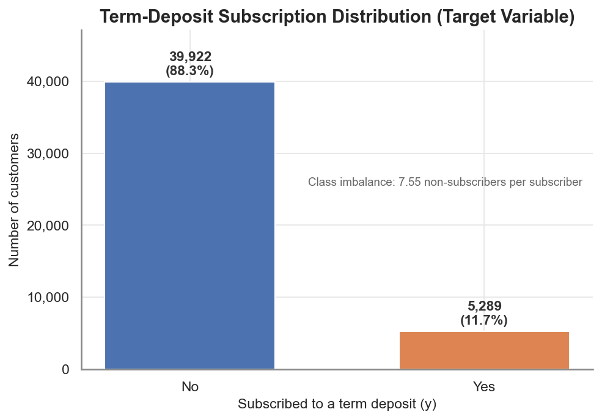

### Customer age distribution

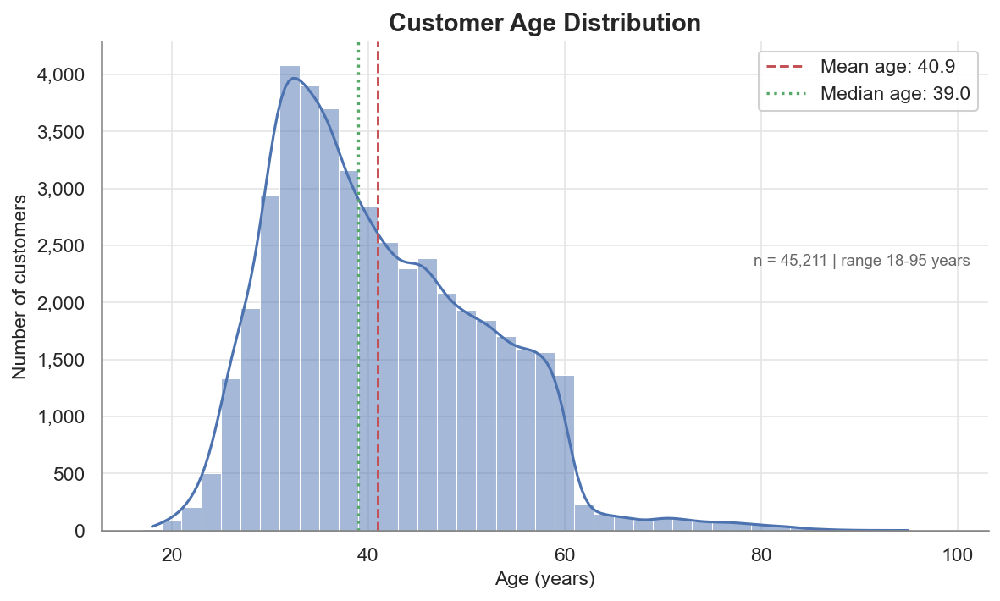

### Customer occupation distribution

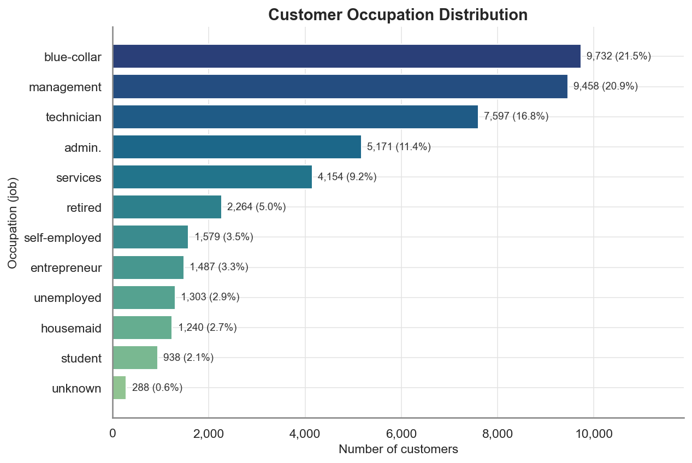

### Account balance distribution

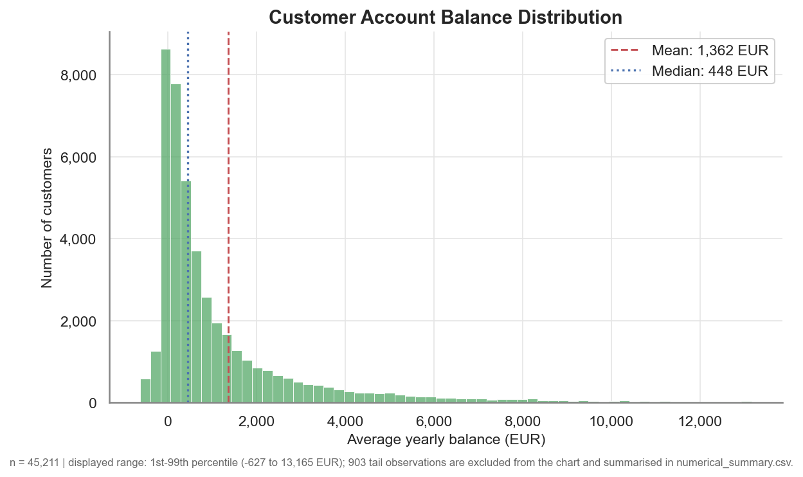

### Subscription rate by occupation

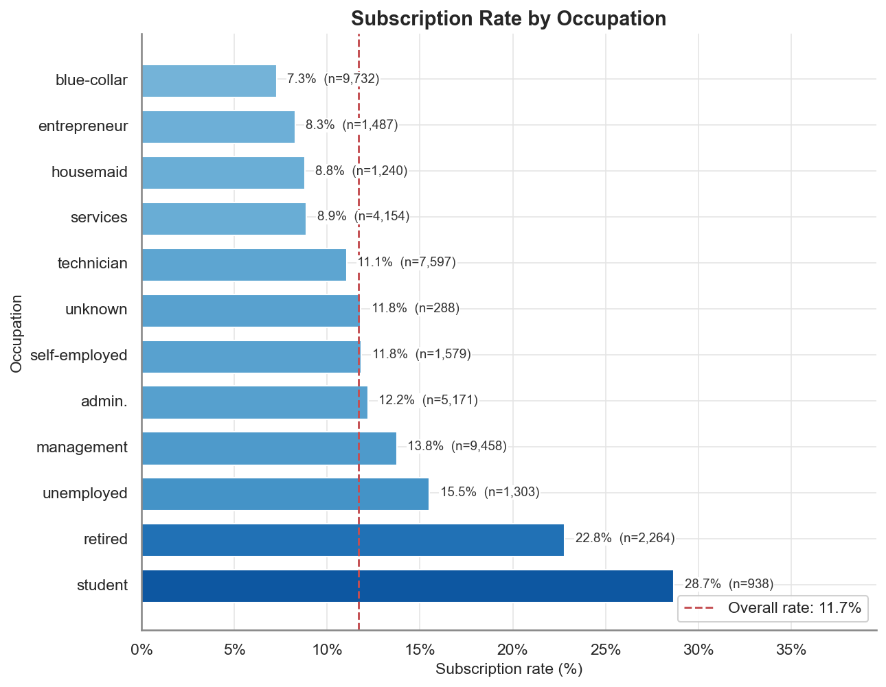

### Subscription rate by age group

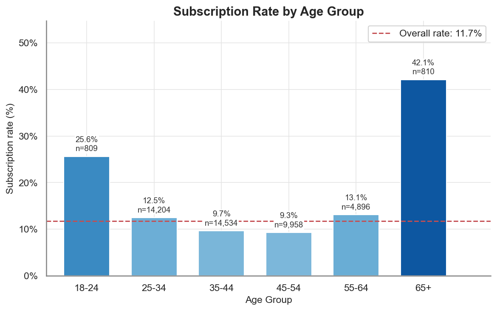

### Subscription rate by marital status

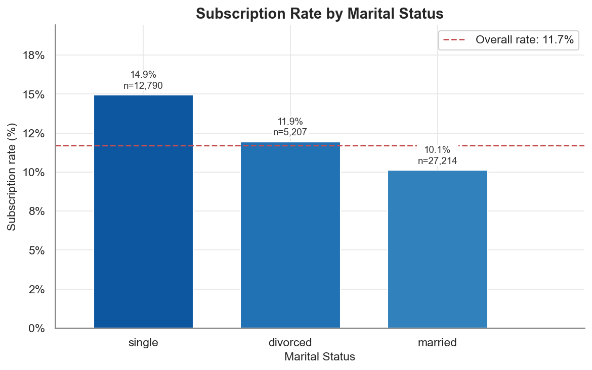

### Subscription rate by education

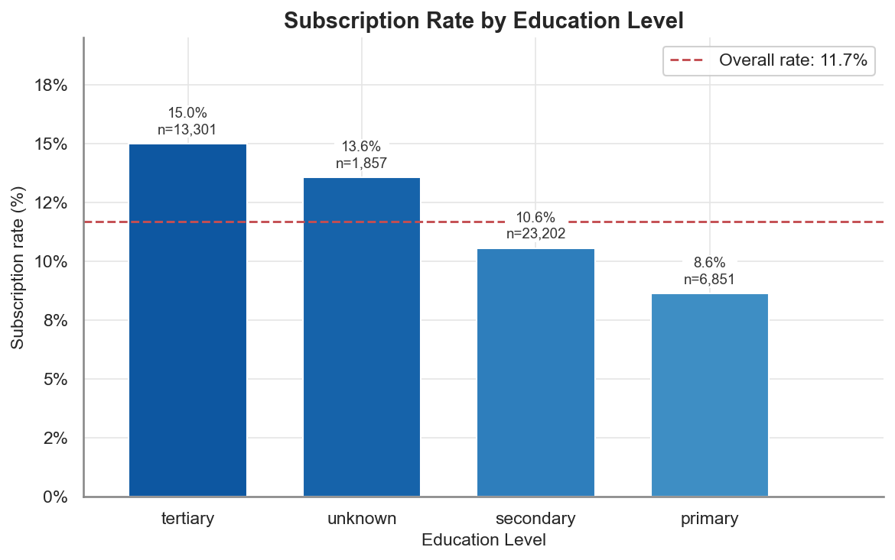

### Subscription rate by previous campaign outcome

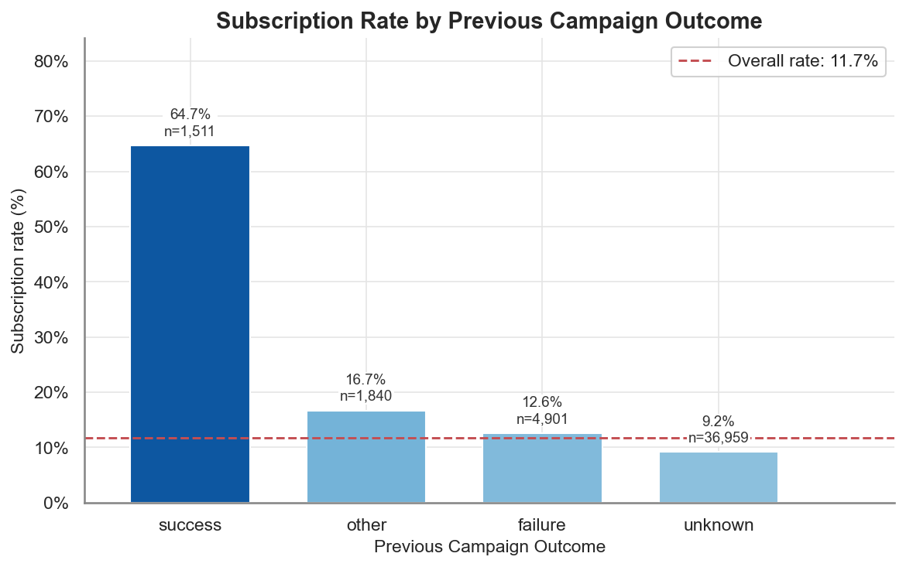

### Subscription rate by contact method

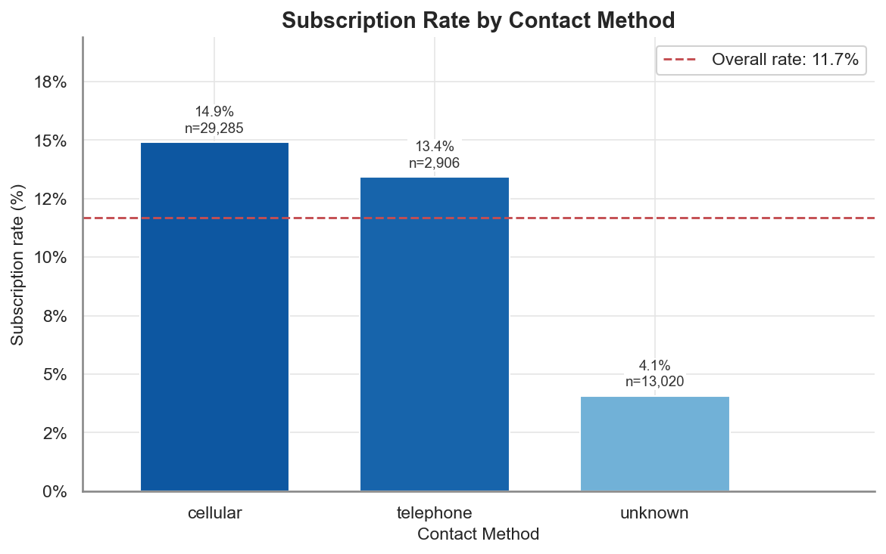

### Correlation heatmap for numerical variables

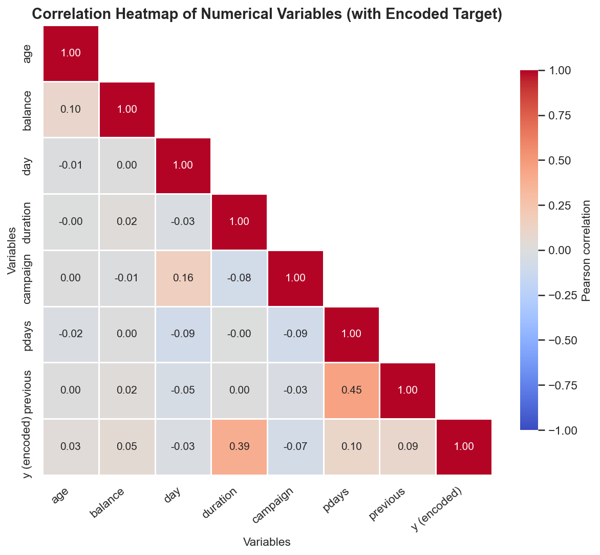

---

## 7. Important data-mining considerations (Task F)

### 7.1 Why the target variable is imbalanced

Term deposits are a low-frequency response product: only **11.70%** of contacts converted. Direct-marketing campaigns deliberately contact many customers to find relatively few interested ones, so imbalance is inherent to the business process rather than a data-collection error. With a 7.55:1 ratio, a model can achieve high apparent accuracy by always predicting the majority class.

### 7.2 Why accuracy alone may be misleading

A constant 'no' model scores **88.30% accuracy** but generates no leads and no revenue. Conversely, a model that misses a likely subscriber loses a sale, while a false positive costs call-centre time. Accuracy gives both errors the wrong weight. Later phases should report **recall/sensitivity, precision, F1, ROC-AUC, PR-AUC, lift at a fixed contact budget, and calibration**, ideally converted into campaign profit or cost per acquired deposit.

### 7.3 Why 'unknown' values need investigation

'unknown' can mean different things: information not collected, customer refused to answer, a legacy-system field, or - for `poutcome` - the customer had no previous campaign. These mechanisms are not missing-at-random. Deleting such rows would remove large, non-representative groups (contact unknown alone is **28.80%** of records) and bias every later model. The recommended treatment is to keep 'unknown' as an explicit category, investigate its relationship with the target, and decide per field (for example, encode `poutcome = unknown` together with `previous = 0`). Only well-justified domain rules should be applied, never automatic row deletion.

### 7.4 Why pdays = -1 has a special meaning

`pdays` is the number of days since the previous campaign contact. The value **-1** is a flag for **'never previously contacted'** and applies to **81.74%** of records. Averaging or correlating `pdays` as a numeric duration mixes two populations: customers with no history and customers contacted 1-871 days ago. This creates an artificial relationship (the raw correlation with the encoded target is +0.104). Better encodings are a binary `was_previously_contacted` flag plus a separate numeric `days_since_previous` defined only for contacted customers.

### 7.5 Why duration may cause data leakage

`duration` is the length of the *last contact* and is recorded only after the call has happened. It has the strongest raw numerical correlation with the target (**+0.395**), but at the moment a customer is selected for calling, the duration is unknown. Using it to predict pre-call subscription would leak post-outcome information and produce optimistic results that cannot be reproduced in a real campaign. For a pre-call targeting model, `duration` should be excluded from the feature set. It is legitimate only for a different use case such as scoring during or after a call.

---

## 8. Key business insights

1. **Previous success is the strongest signal.** Customers with `poutcome = success` convert at **64.73%** (n=1,511), roughly **5.5x** the overall rate. A warm re-contact list should be a campaign priority.
2. **Occupation matters.** Students (**28.68%**, n=938) and retirees (**22.79%**, n=2,264) convert well; blue-collar workers (**7.27%**, n=9,732) form the largest group but convert least. High-volume segments are not automatically high-value segments.
3. **Age is non-linear.** Customers aged 65+ convert at **42.10%** and 18-24-year-olds at a comparatively high rate, while the large 35-54 core converts around **9.27%**. Age should be modelled as non-linear or binned, not as a simple straight-line effect.
4. **Channel quality differs.** Cellular contact converts at **14.92%** versus **4.07%** for unknown contact records. The unknown channel group is also large, so channel data quality and contactability deserve attention.
5. **Existing debt reduces response.** Customers without a housing loan convert at **16.70%** versus **7.70%** with one; the pattern is similar for personal loans (**12.66%** vs **6.68%**). Affordability should inform targeting and product framing.
6. **Education and marital status add context.** Tertiary-educated customers convert at **15.01%** and single customers at **14.95%**, both above the baseline; these variables are correlated with age and occupation, so their independent effect must be tested in a multivariate model.
7. **Timing is uneven but confounded.** The highest observed monthly rate is **51.99% in mar** (n=477), while the busiest month, **may**, has 13,766 contacts but a rate of 6.72%. Month is entangled with campaign design, seasonality, and sample size; it is a candidate feature, not a standalone recommendation.

---

## 9. Limitations and concerns

- **No ground truth for 'unknown'.** 'unknown' categories may hide different real states; treating them uniformly could distort segment interpretation.
- **Class imbalance.** With only 11.70% positives, accuracy is misleading and minority-class performance must be evaluated explicitly.
- **Potential leakage.** `duration` is post-contact information and must be excluded from pre-call models; `pdays = -1` is a sentinel, not a number.
- **Outliers and skew.** Balance and duration are heavily skewed; balance also contains negative values. Any scaling or capping must be fitted on training data only.
- **No year field.** The data span May 2008 - November 2010 but only day and month are recorded, so long-term trends and macroeconomic effects cannot be modelled directly.
- **Historical and local context.** This is one Portuguese bank's 2008-2010 campaign data; customer behaviour, regulation, and channel mix may differ today.
- **No cost/revenue variables.** The analysis cannot quantify the profit of a contact or the cost of a false positive; later phases need campaign economics.
- **Small segments.** Some rates (for example months with fewer than 1,000 contacts) are based on small samples and should not be over-interpreted.
- **Correlation is not causation.** Segment differences may reflect confounding between age, job, education, campaign timing, and contact history.
- **No modelling performed.** Phase 1 is descriptive only; no train/test split, feature selection, or model evaluation has been done.

---

## 10. Reproducibility

Run everything from the project root:

```bash
python src/phase1_exploration.py
```

Optional arguments:

```bash
python src/phase1_exploration.py \
    --data data/raw/bank-full.csv \
    --output-dir reports/phase1 \
    --dpi 200
```

The script validates the input path and schema, never modifies the raw CSV, and regenerates every CSV, chart, and this report deterministically (apart from the generation timestamp).

### Generated artefacts

- `dataset_summary.csv`
- `missing_values.csv`
- `unknown_values.csv`
- `categorical_summary.csv`
- `numerical_summary.csv`
- `target_distribution.csv`
- `subscription_rates_by_segment.csv`
- `phase1_report.md`
- `01_target_distribution.png`
- `02_age_distribution.png`
- `03_job_distribution.png`
- `04_balance_distribution.png`
- `05_subscription_rate_by_job.png`
- `06_subscription_rate_by_age_group.png`
- `07_subscription_rate_by_marital_status.png`
- `08_subscription_rate_by_education.png`
- `09_subscription_rate_by_poutcome.png`
- `10_subscription_rate_by_contact.png`
- `11_correlation_heatmap.png`
