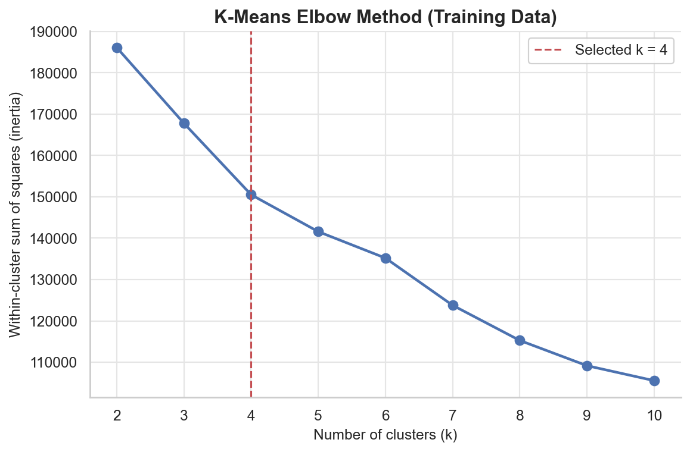
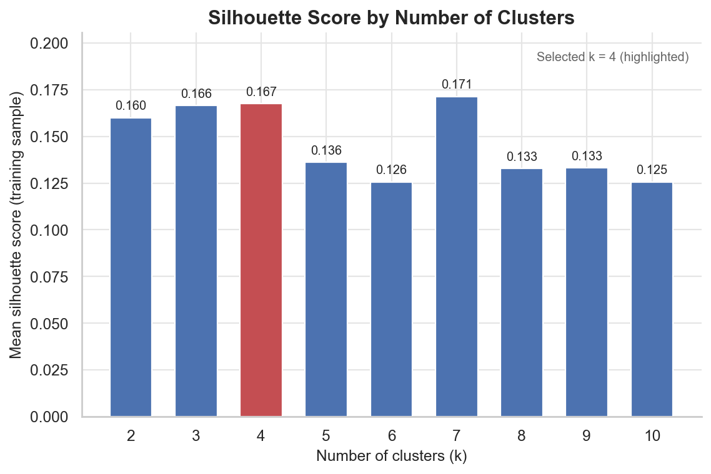
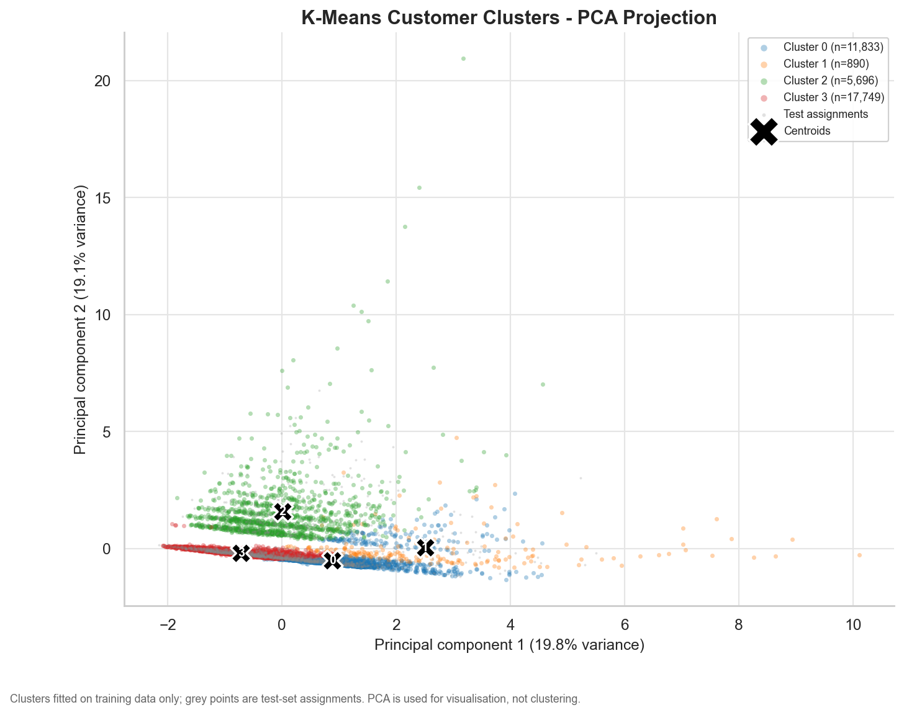

# K-Means Customer Segmentation Report

**Generated:** 2026-11-17 19:38:00  
**Method:** StandardScaler + OneHotEncoder + K-Means  
**Selected clusters:** 4  
**Training customers:** 36,168  
**Input features:** `age`, `balance`, `previous`, `default`, `housing`, `loan`, `has_previous_contact`, `previous_campaign_success`, `job`, `marital`, `education`, `poutcome`

> **Independence statement:** the target `y` and `duration` were not used as clustering inputs. `y` appears only after clustering, as a post-hoc observed subscription rate to help interpret the segments.

---

## 1. Approach

K-Means is an unsupervised task, independent of the supervised classifiers. It uses stable customer profile attributes (age, balance, occupation, marital status, education, loans, default) and prior campaign history. Current-campaign execution fields (`contact`, `day`, `month`, `campaign`) and `duration` are excluded so that segments describe customers rather than campaign tactics.

- Numerical features are standardized and nominal features are one-hot encoded inside a training-only pipeline.
- The resulting training matrix has 31 features.
- The same 80/20 customer split as Phase 2 is reproduced; the saved `y_train.csv` is used only to verify row identity.

## 2. Choosing the number of clusters

The Elbow Method examines inertia, while silhouette scores measure cluster cohesion and separation. The selection rule is: choose the highest silhouette among solutions where every cluster has at least 2% of training customers.

| k | inertia | silhouette_score | min_cluster_count | min_cluster_share_pct | cluster_sizes |
| --- | --- | --- | --- | --- | --- |
| 2 | 186080.86 | 0.16 | 14,142 | 39.10 | 14142, 22026 |
| 3 | 167778.89 | 0.17 | 5,835 | 16.13 | 5835, 18268, 12065 |
| 4 | 150512.02 | 0.17 | 890 | 2.46 | 11833, 890, 5696, 17749 |
| 5 | 141582.14 | 0.14 | 801 | 2.21 | 6763, 10407, 5457, 12740, 801 |
| 6 | 135192.94 | 0.13 | 788 | 2.18 | 4891, 6843, 788, 9374, 8871, 5401 |
| 7 | 123777.29 | 0.17 | 1 | 0.00 | 11188, 5208, 1, 1944, 170, 472, 17185 |
| 8 | 115274.77 | 0.13 | 1 | 0.00 | 9248, 7477, 155, 1, 12029, 1695, 472, 5091 |
| 9 | 109175.72 | 0.13 | 1 | 0.00 | 5674, 5779, 152, 1, 9231, 1574, 471, 5067, 8219 |
| 10 | 105557.81 | 0.13 | 1 | 0.00 | 1354, 6023, 6899, 5532, 470, 5000, 87, 1, 5049, 5753 |

**Selected k = 4.** Silhouette scores are modest, which is normal for mixed banking data with one-hot dimensions; the value is in interpretability and business differentiation, not in a high absolute score. Very large k values produced tiny or singleton clusters and were rejected by the minimum-share guardrail.

- Training silhouette (5,000-row sample): **0.1674**
- Held-out test silhouette (assignment generalisation check): **0.1697**





## 3. Cluster visualisation



PCA is used only for two-dimensional display; K-Means uses the full scaled/encoded feature space.

## 4. Cluster profiles

| cluster | n_customers | share_pct | age_mean | balance_median | top_job | top_job_pct | top_education | pct_housing_loan | pct_previous_contact | observed_subscription_rate_pct |
| --- | --- | --- | --- | --- | --- | --- | --- | --- | --- | --- |
| 0 | 11,833 | 32.72 | 52.37 | 529.00 | blue-collar | 21.63 | secondary | 41.36 | 5.97 | 10.39 |
| 1 | 890 | 2.46 | 43.03 | 12054.50 | management | 33.37 | tertiary | 45.39 | 18.65 | 14.49 |
| 2 | 5,696 | 15.75 | 38.32 | 538.00 | management | 22.79 | secondary | 67.03 | 100.00 | 21.01 |
| 3 | 17,749 | 49.07 | 33.96 | 341.00 | blue-collar | 22.34 | secondary | 62.35 | 0.08 | 9.44 |

Full profiles, including marital status, loans, default, previous success, and top poutcome, are in `cluster_profiles.csv`.

## 5. Segment interpretation

### Cluster 0 - 11,833 customers (32.7%)

- Mean age **52.4 years**; median balance **529 EUR**; mean previous contacts **0.10**.
- Most common job **blue-collar** (21.6%), education **secondary** (44.9%), marital status **married** (78.1%).
- Housing loan **41.4%**, personal loan **16.4%**, credit default **1.7%**.
- Previous campaign contact **6.0%**; previous success **1.9%**.
- Observed subscription rate (post-hoc, not used for clustering): **10.39%** (-1.31 pp vs overall 11.70%).

**Interpretation:** older, mid-balance customers; most common job is blue-collar (22%), 41% have a housing loan, and 6% had previous campaign contact.

This segment is near the overall conversion rate; it can support volume campaigns but is less differentiated than the extremes.

### Cluster 1 - 890 customers (2.5%)

- Mean age **43.0 years**; median balance **12,054 EUR**; mean previous contacts **0.51**.
- Most common job **management** (33.4%), education **tertiary** (46.3%), marital status **married** (64.7%).
- Housing loan **45.4%**, personal loan **4.9%**, credit default **0.1%**.
- Previous campaign contact **18.7%**; previous success **4.7%**.
- Observed subscription rate (post-hoc, not used for clustering): **14.49%** (+2.80 pp vs overall 11.70%).

**Interpretation:** older, high-balance customers; most common job is management (33%), 45% have a housing loan, and 19% had previous campaign contact.

This segment is above-average in observed conversion and is a candidate for priority outreach or a targeted term-deposit offer.

### Cluster 2 - 5,696 customers (15.7%)

- Mean age **38.3 years**; median balance **538 EUR**; mean previous contacts **3.40**.
- Most common job **management** (22.8%), education **secondary** (53.1%), marital status **married** (54.3%).
- Housing loan **67.0%**, personal loan **14.2%**, credit default **0.8%**.
- Previous campaign contact **100.0%**; previous success **16.3%**.
- Observed subscription rate (post-hoc, not used for clustering): **21.01%** (+9.32 pp vs overall 11.70%).

**Interpretation:** younger, mid-balance customers; most common job is management (23%), 67% have a housing loan, and 100% had previous campaign contact.

This segment is above-average in observed conversion and is a candidate for priority outreach or a targeted term-deposit offer.

### Cluster 3 - 17,749 customers (49.1%)

- Mean age **34.0 years**; median balance **341 EUR**; mean previous contacts **0.00**.
- Most common job **blue-collar** (22.3%), education **secondary** (55.7%), marital status **married** (49.9%).
- Housing loan **62.3%**, personal loan **17.0%**, credit default **2.2%**.
- Previous campaign contact **0.1%**; previous success **0.0%**.
- Observed subscription rate (post-hoc, not used for clustering): **9.44%** (-2.26 pp vs overall 11.70%).

**Interpretation:** younger, low-balance customers; most common job is blue-collar (22%), 62% have a housing loan, and 0% had previous campaign contact.

This segment is below-average in observed conversion; use lower-cost channels or a different product proposition rather than high-contact campaigns.

## 6. Held-out test assignment check

| cluster | n_customers | share_pct |
| --- | --- | --- |
| 0 | 3,026 | 33.46 |
| 1 | 234 | 2.59 |
| 2 | 1,447 | 16.00 |
| 3 | 4,336 | 47.95 |

The test distribution is a descriptive stability check only. Test customers did not influence the scaler, encoder, or centroids.

## 7. Business use and limitations

- Segments can guide differentiated offers, channel choice, and contact frequency; they do not replace the supervised conversion model.
- K-Means assumes roughly spherical, equally sized clusters and uses Euclidean distance on one-hot dimensions.
- The silhouette score is modest; cluster boundaries are not sharp, and membership should be treated as a marketing heuristic.
- The observed subscription rate is descriptive and not causal. It was not used to fit the clusters.
- Cluster labels are arbitrary numeric IDs; business names should be agreed with marketing stakeholders.

## 8. Reproduce

```bash
python src/phase3_models.py
```

The clustering step is deterministic with `random_state=42` and `n_init=10`; it is fitted on the same training rows as the classifiers.
