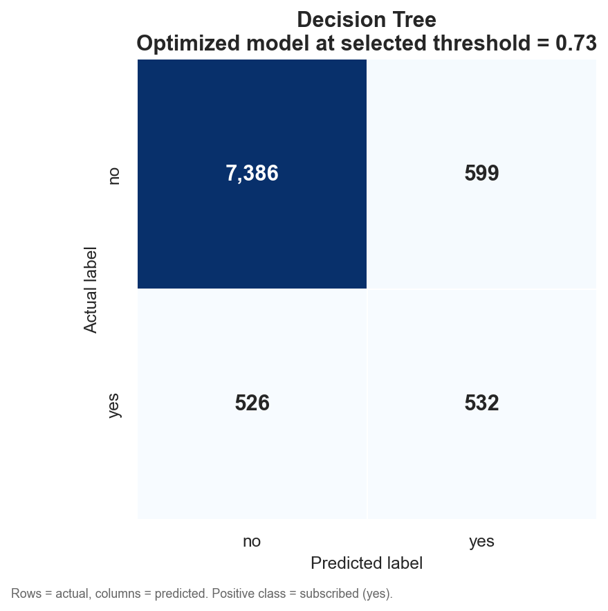
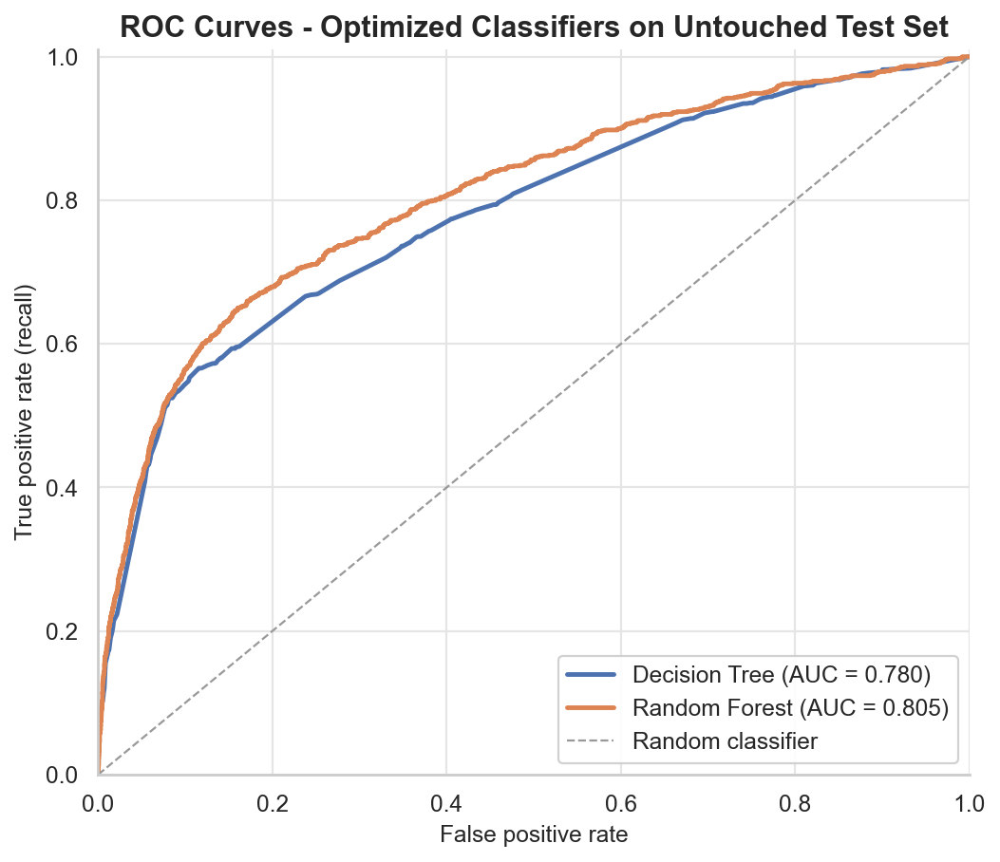
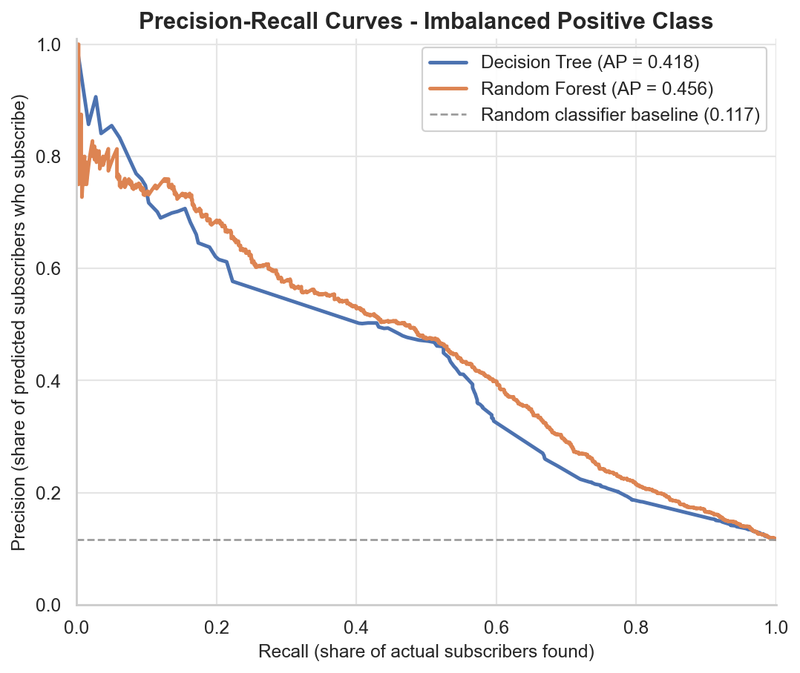
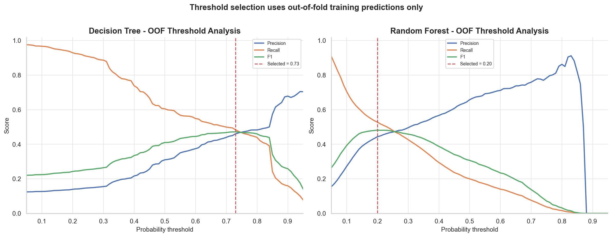

# Phase 4 - Model Evaluation, Optimization and Selection

**Project:** Bank Marketing Intelligence System  
**Course context:** Information Systems Management  
**Generated:** 2026-11-17 20:06:59  
**Scope:** Phase 4 only. Phase 5 was not started.  
**Positive class:** `y = yes` (subscribed to a term deposit).

---

## 1. Executive summary

The final selected model is **Random Forest** with an OOF-selected probability threshold of **0.20**. The threshold was chosen from out-of-fold training predictions, not from the test set.

On the untouched test set, it achieves **F1=0.4902**, **recall=0.5321**, **precision=0.4544**, **ROC-AUC=0.8046**, and **average precision=0.4557**. It identifies **563 of 1,058** actual subscribers while making **1,239** predicted positive contacts.

The existing Phase 3 models and all data artifacts were verified before Phase 4. The test set was not used for hyperparameter or threshold selection. `duration` remains excluded, so this is a pre-call model.

---

## 2. Data and evaluation protocol

- Training customers: **36,168**; test customers: **9,043**; test subscribers: **1,058 (11.70%)**.
- Model inputs: **59** Phase 2 processed features.
- `duration` is absent from the classifier inputs.
- Hyperparameter selection: RandomizedSearchCV with **StratifiedKFold(5, shuffle=True, random_state=42)**, optimising **average_precision** on training data only.
- Threshold selection: out-of-fold training probabilities; the test set is used once per optimized model at its selected threshold.
- The Phase 2 fitted preprocessing pipeline is loaded and reused, not refitted.

### Existing Phase 3 test metrics at 0.50

| model | accuracy | precision | recall | f1 | roc_auc | average_precision | true_positive | false_positive | false_negative |
| --- | --- | --- | --- | --- | --- | --- | --- | --- | --- |
| Decision Tree | 0.83 | 0.36 | 0.58 | 0.44 | 0.78 | 0.39 | 614 | 1,108 | 444 |
| Random Forest | 0.87 | 0.45 | 0.52 | 0.49 | 0.80 | 0.45 | 555 | 670 | 503 |

These values reproduce the Phase 3 test results. They are retained as the baseline against which Phase 4 optimization is compared.

---

## 3. Task 1 - Model performance comparison

### Baseline Phase 3 models

| model | accuracy | precision | recall | f1 | roc_auc | average_precision | predicted_positive |
| --- | --- | --- | --- | --- | --- | --- | --- |
| Decision Tree | 0.83 | 0.36 | 0.58 | 0.44 | 0.78 | 0.39 | 1,722 |
| Random Forest | 0.87 | 0.45 | 0.52 | 0.49 | 0.80 | 0.45 | 1,225 |

### Phase 4 optimized models at OOF-selected thresholds

| model | threshold | accuracy | precision | recall | f1 | roc_auc | average_precision | predicted_positive |
| --- | --- | --- | --- | --- | --- | --- | --- | --- |
| Decision Tree | 0.73 | 0.88 | 0.47 | 0.50 | 0.49 | 0.78 | 0.42 | 1,131 |
| Random Forest | 0.20 | 0.87 | 0.45 | 0.53 | 0.49 | 0.80 | 0.46 | 1,239 |

Accuracy is shown for completeness but is not the selection criterion: the majority-class baseline is 88.30%, so a model can look accurate while finding few subscribers. The positive-class metrics and PR-AUC are more informative.

---

## 4. Task 2 - Confusion matrix analysis

The operational meaning of each cell is:

| Outcome | Meaning | Marketing consequence |
| --- | --- | --- |
| **TP** | Actual subscriber, predicted subscriber | Correctly targeted contact; campaign revenue opportunity. |
| **TN** | Non-subscriber, predicted non-subscriber | Correctly avoided contact; saves call-centre budget. |
| **FP** | Non-subscriber, predicted subscriber | Wasted call/offer cost; the price of higher recall. |
| **FN** | Actual subscriber, predicted non-subscriber | Missed sale and lost customer attention; the price of higher precision. |

### Decision Tree at selected threshold 0.73

- TN = **7,386**, FP = **599**, FN = **526**, TP = **532**.
- The model predicts **1,131** positives (12.51% of customers); actual positives number **1,058**.

### Random Forest at selected threshold 0.20

- TN = **7,309**, FP = **676**, FN = **495**, TP = **563**.
- The model predicts **1,239** positives (13.70% of customers); actual positives number **1,058**.

A high-recall operating point accepts more false positives to reduce false negatives. A high-precision operating point does the opposite. The bank should choose based on call capacity and the relative cost of a wasted call versus a missed subscriber.




---

## 5. Task 3 - ROC and precision-recall analysis

ROC-AUC measures ranking across all thresholds. Precision-Recall is especially useful here because the positive class is only 11.70% of the test set. A ROC curve can look strong even when the positive-class precision is low, because the large negative class dominates the false positive rate. The PR curve focuses directly on how many predicted subscribers are real and how many actual subscribers are found.

| model | roc_auc | average_precision |
| --- | --- | --- |
| Decision Tree | 0.78 | 0.42 |
| Random Forest | 0.80 | 0.46 |





Average precision (AP) is the area under the PR curve and is a useful summary for the minority positive class. It should be read alongside the operating threshold, because the chosen threshold determines the actual precision/recall balance used by marketing.

---

## 6. Task 4 - Hyperparameter optimization

### Search design

- Decision Tree: RandomizedSearchCV, **80** candidates, 5-fold stratified CV, scoring = **average_precision**.
- Decision Tree search space: `max_depth`, `min_samples_split`, `min_samples_leaf`, `criterion`, `class_weight`.
- Random Forest: RandomizedSearchCV, **36** candidates, 5-fold stratified CV, scoring = **average_precision**.
- Random Forest search space: `n_estimators`, `max_depth`, `min_samples_split`, `min_samples_leaf`, `max_features`, `class_weight`.
- Every search fit used training data only. The test set was not passed to either search object.

### Selected hyperparameters

| model | cv_average_precision | search_time_seconds | best_params |
| --- | --- | --- | --- |
| Decision Tree | 0.40 | 10.57 | {"class_weight": "balanced", "criterion": "gini", "max_depth": 10, "min_samples_leaf": 50, "min_samples_split": 2} |
| Random Forest | 0.44 | 255.30 | {"class_weight": null, "max_depth": 18, "max_features": 0.3, "min_samples_leaf": 10, "min_samples_split": 5, "n_estimators": 400} |

Criterion and class-weight choices were therefore not assumed: both were included in the search. `balanced_subsample` was available for the Random Forest because it can behave differently from `balanced` when bootstrap samples vary.

---

## 7. Task 5 - Prediction threshold analysis

Thresholds were evaluated on out-of-fold training probabilities. The table below reports OOF precision, recall and F1; the selected threshold maximises OOF F1, with ties resolved toward higher recall.

| model | threshold | oof_precision | oof_recall | oof_f1 | oof_predicted_positive |
| --- | --- | --- | --- | --- | --- |
| Decision Tree | 0.73 | 0.46 | 0.48 | 0.47 | 4,445 |
| Random Forest | 0.20 | 0.44 | 0.53 | 0.48 | 5,040 |

The required example thresholds are shown below for context. They are OOF training results, not test-set tuning results. The full 0.05-0.95 grid is in `threshold_comparison.csv`.

| model | threshold | oof_precision | oof_recall | oof_f1 | oof_predicted_positive |
| --- | --- | --- | --- | --- | --- |
| Decision Tree | 0.20 | 0.14 | 0.93 | 0.24 | 28,156 |
| Decision Tree | 0.30 | 0.16 | 0.89 | 0.26 | 24,157 |
| Decision Tree | 0.40 | 0.22 | 0.74 | 0.33 | 14,450 |
| Decision Tree | 0.50 | 0.31 | 0.61 | 0.41 | 8,257 |
| Decision Tree | 0.60 | 0.37 | 0.55 | 0.45 | 6,199 |
| Random Forest | 0.20 | 0.44 | 0.53 | 0.48 | 5,040 |
| Random Forest | 0.30 | 0.50 | 0.43 | 0.46 | 3,638 |
| Random Forest | 0.40 | 0.57 | 0.29 | 0.39 | 2,195 |
| Random Forest | 0.50 | 0.66 | 0.20 | 0.31 | 1,286 |
| Random Forest | 0.60 | 0.71 | 0.14 | 0.23 | 832 |

The two selected thresholds are not directly comparable as calibrated probabilities. The Random Forest uses `class_weight=None`, so its probabilities are concentrated at lower values; the Decision Tree uses `class_weight='balanced'`, which pushes its scores upward. Each threshold is best interpreted as a model-specific decision boundary chosen on that model's OOF ranking.



Lowering the threshold increases recall (more actual subscribers found) but usually lowers precision and increases call volume. Raising the threshold does the opposite. For the selected Random Forest, the OOF point at 0.20 finds **2,235** true positives and **2,805** false positives; at 0.50 the OOF operating point would trade recall for precision and a smaller contact list. The selected threshold is an F1-oriented starting point; the bank can move it according to call-centre capacity without refitting the model.

---

## 8. Task 6 - K-Means evaluation

The existing Phase 3 K-Means model was reviewed in `clustering_evaluation.md`. It selected k=4 with training silhouette 0.1674; the target and duration were not clustering inputs. The segmentation should be used as a descriptive overlay on the supervised ranking model, not as a replacement for it.

---

## 9. Task 7 - Final model selection

### Selection rule

The model and threshold were selected from **out-of-fold training metrics**, with positive-class F1 as the primary criterion and average precision as supporting evidence. Accuracy was not used to choose the model.

### Why this model

**Random Forest** achieved the strongest OOF F1 (0.4821) and OOF average precision (0.4423) among the optimized candidates. Its test performance confirms the choice without having been used to make it: F1 **0.4902**, recall **0.5321**, precision **0.4544**, ROC-AUC **0.8046**, AP **0.4557** at threshold **0.20**.

### Trade-offs

- **Recall:** the selected model is compared with the other optimized model in the results table. If campaign capacity is high, a lower threshold from `threshold_comparison.csv` can increase recall further.
- **Precision:** a higher threshold reduces wasted calls but can miss subscribers. The PR curve and threshold table make this trade-off explicit.
- **Interpretability:** the Decision Tree can be read as if/then rules and is preferable when an auditable policy explanation is mandatory. The selected model is less transparent internally than a single tree, but its feature importances and threshold support governance and campaign monitoring.
- **Computational cost:** the search took 255.3s for the selected model. Prediction is fast enough for batch campaign scoring; the saved model and threshold can be loaded for Phase 5 integration.
- **Business objective:** the bank needs a repeatable ranking of likely subscribers, not the highest raw accuracy. The selected model has the best OOF F1 and PR-AUC, the highest ROC-AUC, and precision close to the Decision Tree while retaining useful recall at the operational threshold.

### Relationship to the Phase 3 baseline

The selected baseline model at 0.50 had F1 **0.4862**, recall **0.5246** and precision **0.4531**. Phase 4's optimized model and threshold produce F1 **0.4902**, recall **0.5321** and precision **0.4544** on the same test set. The comparison is descriptive; the test set was not used to choose the Phase 4 configuration.

The test-set gain over the Phase 3 Random Forest is modest (F1 +0.0040, recall +0.0076, precision +0.0013). This indicates that the Phase 3 Random Forest was already near its practical plateau on these features. The most useful Phase 4 outcome is the explicit, training-only threshold policy and the evidence that the optimized tree closes much of the gap but does not overtake the ensemble on PR-AUC.

---

## 10. Validation and limitations

- All required models loaded successfully; the selected artifact was reloaded and its predictions were checked.
- The test set remained untouched during search and threshold selection.
- `duration` is not present in the model input features; this is a pre-call prediction setup.
- The test set contains 1,058 subscribers (11.70%). Minority-class metrics are therefore more relevant than accuracy.
- No campaign cost or revenue data are available, so the threshold is an F1-oriented default rather than a profit-optimal decision. Marketing should set the final operating point using call capacity and cost per call.
- Phase 2 scaling/encoding was fitted on the training split before CV. The CV estimates are therefore slightly optimistic for the preprocessing step, although the test set is untouched. In a production retraining pipeline, fit preprocessing inside each CV fold.
- The OOF threshold shares the training folds used for model selection, so it is a validation estimate rather than a fully independent holdout. The untouched test evaluation is the final external check.
- The K-Means segments are descriptive and use no target labels; they should complement, not replace, the supervised ranking model.

---

## 11. Reproduction

```powershell
cd "D:\LEARNING\Information System Manangement\Project"
python src/phase4_evaluation.py
```

Optional paths:

```powershell
python src/phase4_evaluation.py `
    --processed-dir data/processed `
    --models-dir models `
    --reports-dir reports/phase4
```

## 12. Outputs

- `models/best_model.joblib` - selected model, Phase 2 preprocessing pipeline, and threshold.
- `models/best_model_metadata.json` - metadata and reuse instructions.
- `reports/phase4/model_comparison.csv`
- `reports/phase4/optimized_model_results.csv`
- `reports/phase4/threshold_comparison.csv`
- `reports/phase4/classification_report.txt`
- `reports/phase4/final_model_selection.md`
- `reports/phase4/clustering_evaluation.md`
- The five required Phase 4 charts.
